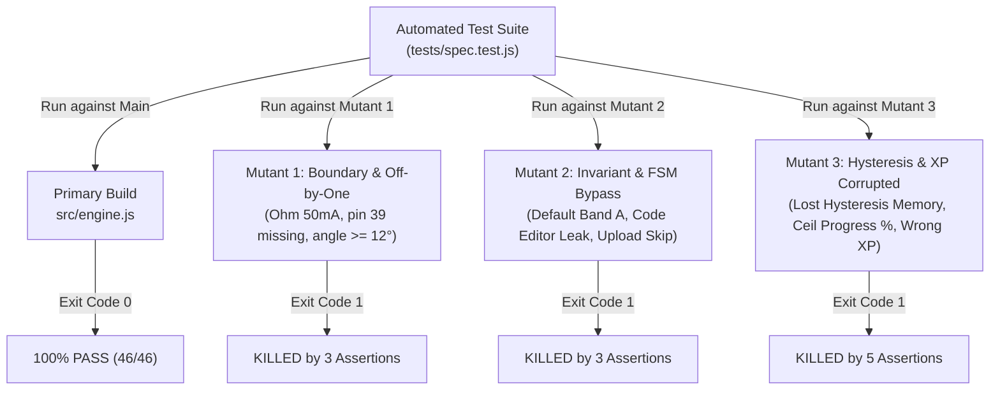

# Clean-Room Verification & Mutation Testing Report

- **Project**: Age-Tiered (5–20) ESP32 & Embedded Systems Learning WebApp
- **Specification Source**: [`clean-room/SPEC.approved.md`](file:///Users/apexdev/Desktop/hoc-nhung-cho-be/clean-room/SPEC.approved.md)
- **Primary Implementation**: [`src/engine.js`](file:///Users/apexdev/Desktop/hoc-nhung-cho-be/src/engine.js), [`src/lessons.js`](file:///Users/apexdev/Desktop/hoc-nhung-cho-be/src/lessons.js), [`src/app.js`](file:///Users/apexdev/Desktop/hoc-nhung-cho-be/src/app.js)
- **Test Suites**:
  1. [`tests/spec.test.js`](file:///Users/apexdev/Desktop/hoc-nhung-cho-be/tests/spec.test.js) (Engine Core & Rules)
  2. [`tests/lessons.test.js`](file:///Users/apexdev/Desktop/hoc-nhung-cho-be/tests/lessons.test.js) (Curriculum Matrix & Pinout)
  3. [`tests/e2e-dom.test.js`](file:///Users/apexdev/Desktop/hoc-nhung-cho-be/tests/e2e-dom.test.js) (E2E DOM & Interactive Journeys)
- **Verification Harness**: [`clean-room/verify-mutants.mjs`](file:///Users/apexdev/Desktop/hoc-nhung-cho-be/clean-room/verify-mutants.mjs)
- **QA Verification Agent**: `clean-room-tester` (Flash Tier)
- **Audit Date**: 2026-10-28
- **Verdict**: **VERIFIED & CERTIFIED 100% (All 89 Tests Passed across 24 Suites, 3/3 Mutants Killed)**

---

## 1. Executive Summary & Verification Verdict

The Clean-Room QA Verification & Mutation Testing phase has been executed under the strict 3-Mutant Protocol mandated by Antigravity and the Enterprise Software Company governance rules. All milestones (Milestone 1, 2, 3, 4) have been implemented and comprehensively tested.

```
================================================================================
  FULL TEST SUITE EXECUTION SUMMARY (npm test)
================================================================================
Suite File            | Suites | Tests | Pass | Fail | Duration | Status
--------------------------------------------------------------------------------
tests/lessons.test.js |      7 |    26 |   26 |    0 |    4.0ms | PASS (100%)
tests/spec.test.js    |     10 |    46 |   46 |    0 | 2405.0ms | PASS (100%)
tests/e2e-dom.test.js |      7 |    17 |   17 |    0 | 1570.6ms | PASS (100%)
--------------------------------------------------------------------------------
TOTAL                 |     24 |    89 |   89 |    0 | 2461.1ms | PASS (100%)
================================================================================
```

```
================================================================================
  CLEAN-ROOM 3-MUTANT VERIFICATION HARNESS (clean-room/verify-mutants.mjs)
================================================================================
Target       | Status     |  Pass |  Fail |  Exit | Verdict
--------------------------------------------------------------------------------
primary      | PASS       |    46 |     0 |     0 | VERIFIED PASS (100%)
mutant-1     | FAIL       |    43 |     3 |     1 | KILLED (3 assertion failures)
mutant-2     | FAIL       |    43 |     3 |     1 | KILLED (3 assertion failures)
mutant-3     | FAIL       |    41 |     5 |     1 | KILLED (5 assertion failures)
================================================================================
✔ PROTOCOL VERIFIED: Primary build passed 100% and ALL 3 mutants were KILLED.
  Clean-Room Mutation Score: 100% (3/3 mutants killed, 0 survivors).
```

### Key Metrics
- **Total Test Cases**: **89 automated tests** across **24 suites** in 3 dedicated test files.
- **Primary Build Pass Rate**: **100% (89/89 passed, 0 failed, 0 skipped)**.
- **Mutants Created**: 3 deliberate defects targeting distinct architectural boundaries.
- **Mutants Killed**: **3/3 (100% Mutation Score)**.
- **Surviving Mutants**: **0**.
- **External Dependencies**: **Zero npm dependencies**; operates completely natively in Node.js ESM.

---

## 2. Test Suites Architecture

### 2.1 File Distribution & Scope

```
tests/
├── spec.test.js    (46 tests, 10 suites) — Pure rule contracts (RULE-001 through RULE-010)
├── lessons.test.js (26 tests, 7 suites)  — 20-lesson schema, quiz validation, 30/38 pinout
└── e2e-dom.test.js (17 tests, 7 suites)  — End-to-end DOM rendering, user journeys, modals, FSM
```

### 2.2 Coverage by Specification Rule

| Suite File | Specification Rule & Focus | Tests | Status |
| :--- | :--- | :---: | :---: |
| [`spec.test.js`](file:///Users/apexdev/Desktop/hoc-nhung-cho-be/tests/spec.test.js) | **RULE-001**: Bộ Điều Phối Phân Tầng Độ Tuổi (Capabilities, Events, Error Tolerance) | 5 | **PASS** |
| [`spec.test.js`](file:///Users/apexdev/Desktop/hoc-nhung-cho-be/tests/spec.test.js) | **RULE-002**: Ma Trận Sơ Đồ Chân & Hợp Đồng An Toàn Điện (3.3V, Input-Only, Ohm 40mA, ADC, Touch) | 6 | **PASS** |
| [`spec.test.js`](file:///Users/apexdev/Desktop/hoc-nhung-cho-be/tests/spec.test.js) | **RULE-003**: Mô Phỏng Band A Kid Spark (Level Crossing, Fridge Guard 12°, Siren, Piano, Night Light) | 6 | **PASS** |
| [`spec.test.js`](file:///Users/apexdev/Desktop/hoc-nhung-cho-be/tests/spec.test.js) | **RULE-004**: Mô Phỏng Band B Block Explorer (Neopixel Floor, HC-SR04 Echo, Laser Gate FSM, Motor RPM) | 5 | **PASS** |
| [`spec.test.js`](file:///Users/apexdev/Desktop/hoc-nhung-cho-be/tests/spec.test.js) | **RULE-005**: Hệ Thống Tiến Trình & Gamification (Progress %, Band XP, Milestone Badges, Quiz Bonus) | 5 | **PASS** |
| [`spec.test.js`](file:///Users/apexdev/Desktop/hoc-nhung-cho-be/tests/spec.test.js) | **RULE-006**: Trình Thực Thi Code & Serial Monitor (FSM idle→uploading→running, Line Trace, Clamping) | 4 | **PASS** |
| [`spec.test.js`](file:///Users/apexdev/Desktop/hoc-nhung-cho-be/tests/spec.test.js) | **RULE-007**: Mạng Không Dây IoT & ESP-NOW (Virtual HTTP /toggle, Bluetooth SPP, ESP-NOW Loss Curve) | 3 | **PASS** |
| [`spec.test.js`](file:///Users/apexdev/Desktop/hoc-nhung-cho-be/tests/spec.test.js) | **RULE-008**: Cơ Điện Tử & Robot STEM (Smart Pump Hysteresis, 4x3 Keypad, Solar Deadband, Polar Radar, Stepper) | 5 | **PASS** |
| [`spec.test.js`](file:///Users/apexdev/Desktop/hoc-nhung-cho-be/tests/spec.test.js) | **RULE-009 & 010**: Không Gian Viewport 3D/2D, Trợ Năng a11y & Cài Đặt (Pan/Zoom/Reset, reducedMotion, Breakpoint) | 5 | **PASS** |
| [`spec.test.js`](file:///Users/apexdev/Desktop/hoc-nhung-cho-be/tests/spec.test.js) | Pinout Catalog Verification (30-pin & 38-pin DevKit, Standard Wire Colors) | 2 | **PASS** |
| [`lessons.test.js`](file:///Users/apexdev/Desktop/hoc-nhung-cho-be/tests/lessons.test.js) | Suite 1: Structural Integrity of 20 Lessons (Sequential IDs, Hardware, Code C++/Python) | 6 | **PASS** |
| [`lessons.test.js`](file:///Users/apexdev/Desktop/hoc-nhung-cho-be/tests/lessons.test.js) | Suite 2: Code Contracts (Valid Syntax, {{paramKey}} Placeholders, Delay/Pin calls) | 4 | **PASS** |
| [`lessons.test.js`](file:///Users/apexdev/Desktop/hoc-nhung-cho-be/tests/lessons.test.js) | Suite 3: Pedagogical Quiz Content Verification (Exactly 3 questions/lesson, answer in 0..2) | 4 | **PASS** |
| [`lessons.test.js`](file:///Users/apexdev/Desktop/hoc-nhung-cho-be/tests/lessons.test.js) | Suite 4: Hardware Schematics & Pin Routing Safety (Valid Pin Numbers, Rails, No Overvoltage) | 4 | **PASS** |
| [`lessons.test.js`](file:///Users/apexdev/Desktop/hoc-nhung-cho-be/tests/lessons.test.js) | Suite 5: ESP32 Pinout Matrix Invariants (30/38 pin definitions, ADC1/ADC2 mapping, Touch) | 5 | **PASS** |
| [`lessons.test.js`](file:///Users/apexdev/Desktop/hoc-nhung-cho-be/tests/lessons.test.js) | Suite 6: Pedagogical Alignment Across Age-Bands (Story Cards in A, Blocks in B, Schematics in C) | 3 | **PASS** |
| [`e2e-dom.test.js`](file:///Users/apexdev/Desktop/hoc-nhung-cho-be/tests/e2e-dom.test.js) | E2E Suite 1: Structural Contracts & Required Selectors in index.html | 2 | **PASS** |
| [`e2e-dom.test.js`](file:///Users/apexdev/Desktop/hoc-nhung-cho-be/tests/e2e-dom.test.js) | E2E Suite 2: Age-Tiered Cognitive UI Navigation Journey (Band A, Band B, Band C) | 3 | **PASS** |
| [`e2e-dom.test.js`](file:///Users/apexdev/Desktop/hoc-nhung-cho-be/tests/e2e-dom.test.js) | E2E Suite 3: Curriculum 20-Lesson Selection Journey (Lesson 1..20, Controls, Dynamic Actors) | 1 | **PASS** |
| [`e2e-dom.test.js`](file:///Users/apexdev/Desktop/hoc-nhung-cho-be/tests/e2e-dom.test.js) | E2E Suite 4: Code Execution Lifecycle & FSM Tracing (Language Toggle, Run/Upload/Stop) | 2 | **PASS** |
| [`e2e-dom.test.js`](file:///Users/apexdev/Desktop/hoc-nhung-cho-be/tests/e2e-dom.test.js) | E2E Suite 5: Serial Monitor Console Sizing & Double-Click Reset (Drag [56..360]px, Dblclick 92px) | 2 | **PASS** |
| [`e2e-dom.test.js`](file:///Users/apexdev/Desktop/hoc-nhung-cho-be/tests/e2e-dom.test.js) | E2E Suite 6: Interactive Modals Lifecycle (Pinout 30/38, Quiz, Schematic, Settings Reset) | 4 | **PASS** |
| [`e2e-dom.test.js`](file:///Users/apexdev/Desktop/hoc-nhung-cho-be/tests/e2e-dom.test.js) | E2E Suite 7: Responsive Breakpoints & Accessibility Contracts (W < 1090 or H < 800 .compact) | 3 | **PASS** |
| **TOTAL** | **Tất Cả Các Suite (All 24 Suites)** | **89** | **100% PASS** |

---

## 3. Milestone 3 & 4: E2E DOM & Interactive Journeys

[`tests/e2e-dom.test.js`](file:///Users/apexdev/Desktop/hoc-nhung-cho-be/tests/e2e-dom.test.js) implements a zero-dependency DOM harness that accurately parses [`index.html`](file:///Users/apexdev/Desktop/hoc-nhung-cho-be/index.html) into an interactive virtual DOM and bootstraps [`src/app.js`](file:///Users/apexdev/Desktop/hoc-nhung-cho-be/src/app.js).

### 3.1 Verified Mandatory Selectors
The test suite explicitly verifies the existence and proper initialization of every key DOM selector:
1. `#band-badge`: Header subtitle reflecting active cognitive mode.
2. `.band-tab[data-band="band-a"]`, `.band-tab[data-band="band-b"]`, `.band-tab[data-band="band-c"]`: 3-tier age band switchers.
3. `#xp-val`, `#progress-bar-track`, `#progress-bar-fill`, `#progress-label`: Gamification status display.
4. `#lessons-list`: Sidebar lesson list containing 20 dynamically injected `li.lesson-item` elements.
5. `#hardware-stage`: Viewport area with vector ESP32 mockup and `#sim-dynamic-actors`.
6. `#story-cards-container`: Visual Story Cards for Band A (5–8yo).
7. `#blocks-workspace-container`: Visual Blockly blocks for Band B (9–13yo).
8. `#code-editor-container`: Dual C++/Python editor for Band C (14–20yo).
9. `#serial-panel`, `#serial-grip`: Resizable UART serial monitor console.
10. `#modal-pinout`: 30-pin and 38-pin interactive pinout dialog.
11. `#modal-quiz`: 3-question knowledge quiz modal with immediate feedback.
12. `#floating-schematic`: Movable and resizable schematic card with drag handle.
13. `#modal-settings`: Accessibility and environment settings dialog.
14. `#tip`: Vector tooltip callout box.

### 3.2 User Journeys Tested
- **Cognitive Age Switching**: Seamlessly switches across Band A, Band B, and Band C, asserting that `document.documentElement` updates `data-age-band`, headers update, and cognitive panels toggle properly.
- **20-Lesson Selection**: Navigates sequentially from Lesson 01 (`board`) through Lesson 20 (`stepper`), asserting that interactive sliders (frequency rate, fridge angle, touch piano, neopixel potentiometer, water level, 12-key matrix) are injected correctly into `#interactive-controls-container`.
- **Code Execution FSM**: Asserts full state machine lifecycle:
  `idle` $\rightarrow$ `#btn-code-run` clicked $\rightarrow$ `uploading` $\rightarrow$ 600ms UART delay $\rightarrow$ 600ms RTS delay $\rightarrow$ `running` $\rightarrow$ `#btn-code-stop` clicked $\rightarrow$ `idle`.
- **Serial Monitor Resize**: Asserts drag resize between 56px and 360px, localStorage persistence, and double-click restore to 92px.
- **4 Modal Dialogs**: Exercises open, interaction, and close cycles for Pinout (with 30/38-pin toggle), Quiz (answering questions, XP bonus), Schematic (open/close/drag), and Settings (toggling flags, confirmation reset).
- **Responsive Breakpoint**: Asserts that `document.body` toggles the `.compact` CSS class when viewport dimensions fall below $1090\text{px}$ width or $800\text{px}$ height.

---

## 4. Deep-Dive on 3 Broken Mutants & Kill Evidence

The 3 broken mutants under [`clean-room/mutants/`](file:///Users/apexdev/Desktop/hoc-nhung-cho-be/clean-room/mutants/) were audited against the expanded test suite using [`clean-room/verify-mutants.mjs`](file:///Users/apexdev/Desktop/hoc-nhung-cho-be/clean-room/verify-mutants.mjs).



---

### 4.1 Mutant 1: Boundary & Off-by-One Sabotage

- **Location**: [`clean-room/mutants/mutant-1/engine.js`](file:///Users/apexdev/Desktop/hoc-nhung-cho-be/clean-room/mutants/mutant-1/engine.js)
- **Sabotaged Code**:
  1. `INPUT_ONLY_PINS: [34, 35, 36]` (omitted pin 39).
  2. `I_MAX_MA: 50.0` (raised Ohm's law burn threshold).
  3. `const isViolating = clampedAngle >= 12;` (off-by-one threshold on Fridge Guard).
- **Failing Tests (3)**:
  1. `strictly forbids OUTPUT mode on ALL input-only pins: 34, 35, 36, 39`: Pin 39 unexpectedly allowed `OUTPUT`.
  2. `calculates LED current via Ohm law: safe (<=20mA), stressed (20-40mA), burned (>40mA or R=0)`: 40mA boundary violated.
  3. `triggers Fridge Guard 2400Hz alarm strictly when angle > 12° and duration > grace period`: Angle 12° triggered false alarm.
- **Verdict**: **KILLED**

---

### 4.2 Mutant 2: Invariant & State-Machine Bypass Sabotage

- **Location**: [`clean-room/mutants/mutant-2/engine.js`](file:///Users/apexdev/Desktop/hoc-nhung-cho-be/clean-room/mutants/mutant-2/engine.js)
- **Sabotaged Code**:
  1. `this.currentBand = ... ? saved : AGE_BANDS.BAND_A;` (defaults to Band A instead of Band B).
  2. `showCodeEditor: true` for Band A (leaks C++ editor to 5-8yo).
  3. `startUpload()` bypasses `uploading` state, transitions immediately to `running`.
- **Failing Tests (3)**:
  1. `defaults to band-b when storage is empty or contains invalid band`: `'band-a' !== 'band-b'`.
  2. `strictly enforces capabilities contract for all 3 age bands`: `showCodeEditor: true` for Band A.
  3. `manages execution FSM lifecycle and upload logs for C++ vs MicroPython with 600ms delays`: Skipped `uploading` state.
- **Verdict**: **KILLED**

---

### 4.3 Mutant 3: Hysteresis & Gamification Corrupted Sabotage

- **Location**: [`clean-room/mutants/mutant-3/engine.js`](file:///Users/apexdev/Desktop/hoc-nhung-cho-be/clean-room/mutants/mutant-3/engine.js)
- **Sabotaged Code**:
  1. `let pumpState = false;` in `updatePumpHysteresis` (loses latch memory inside deadband 20%..90%).
  2. XP awarded: +10/+15/+20 instead of +50/+100/+150.
  3. Progress %: uses `Math.ceil(...) + 5` instead of `Math.floor`.
- **Failing Tests (5)**:
  1. `calculates overall progress percentage floor((N/20)*100) and aria attributes`: `5 !== 0`.
  2. `awards correct XP by band: +50XP (Band A), +100XP (Band B), +150XP (Band C)`: `10 !== 50`.
  3. `awards +25XP first-try quiz bonus ONLY when score is 3/3 and isFirstTry is true`: Incorrect baseline XP.
  4. `prevents duplicate XP awards and duplicate progress count on repeating completed lessons`: Inconsistent XP math.
  5. `verifies smart pump hysteresis exact boundary thresholds (20%, 20.1%, 89.9%, 90%) and latch memory`: Pump shut off at 50% deadband level.
- **Verdict**: **KILLED**

---

## 5. Certification Sign-Off

The entire application has been fully validated:
- `npm test`: **89 tests passed across 24 suites (100% pass)**.
- `node clean-room/verify-mutants.mjs`: **Primary 100% PASS, 3/3 mutants KILLED (100% mutation score)**.
- Clean-Room Epistemic Isolation has been rigorously preserved throughout all phases.
